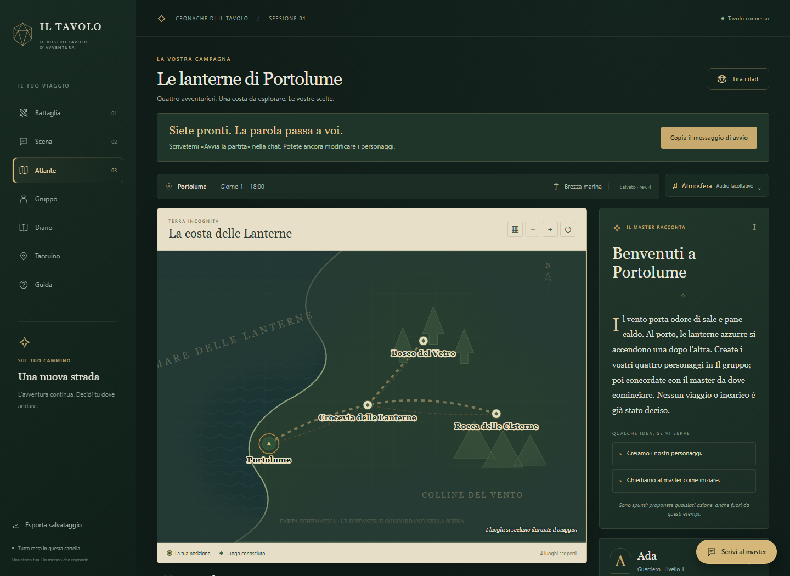

# Il Tavolo

**La vostra avventura, con un punto di ripresa.**

Una plancia locale per quattro giocatori e un master in chat: schede, mappa,
combattimenti, dadi, inventari e diario restano insieme, anche fra una sessione
e la successiva. L'interfaccia è in italiano; il motore gira sul vostro computer.



## Si comincia così

Serve **Python 3.10 o successivo**. Per giocare non occorrono pacchetti aggiuntivi.

```bash
python server.py
```

Aprite **http://127.0.0.1:8765**. Su Windows basta anche un doppio clic su
`AVVIA.cmd`; `ARRESTA.cmd` chiude il server locale. Al primo avvio viene creato
lo scenario originale di esempio, con quattro posti vuoti. Un salvataggio già
presente viene conservato.

1. Create i personaggi in **Il gruppo**: dodici classi, cinque specie, caratteristiche
   e competenze. Nomi e scelte spettano a voi; potete ripetere una classe.
2. Concordate la prima scena con il master, umano o assistente con accesso ai file.
3. Scrivete in chat: **«Ada: esamino la bacheca sul molo»**.
4. Il master risolve l'intenzione e salva gli esiti. La plancia si aggiorna in circa
   due secondi.

Il pulsante **Prepara e copia** aiuta a comporre il messaggio: dovete ancora
incollarlo e inviarlo nella chat. L'app non include un chatbot e non chiama API
di modelli. L'eventuale servizio usato per il master ha requisiti propri.

## Cosa trovate

- **Battaglia**: iniziativa, PF, condizioni, pedine e anteprime delle aree di magia.
- **Scena e Atlante**: situazione corrente, luoghi conosciuti e scelte libere.
- **Gruppo**: quattro schede indipendenti, risorse ed equipaggiamento.
- **Diario e Taccuino**: obiettivi, indizi confermati, ipotesi personali e inventari.
- **Atmosfera**: suoni attivabili, illustrazioni e cartoteca con esempi originali.
- **Continuità**: copie del salvataggio, diario privato e passaggio alla chat successiva.

Le regole riassunte si basano sul **SRD 5.1 del 2014**. Il master verifica
prerequisiti, distanze e reazioni; nessun pulsante decide azioni o spese dei PG.
Il demo di **Portolume** è una cornice originale da espandere, non una campagna
pubblicata completa. PDF commerciali e partite personali non sono distribuiti.

## Per approfondire

- [Installazione, salvataggi e problemi comuni](docs/GETTING_STARTED.md)
- [Guida per il master](docs/DM_GUIDE.md)
- [Comandi pronti](tools/PLAYBOOK.md)
- [Come contribuire](CONTRIBUTING.md)
- [Preparare una copia pubblicabile](docs/PUBLISHING.md)

Il server è locale, su **127.0.0.1**, per un computer condiviso. Non è un servizio
multigiocatore remoto. Codice originale MIT, regole derivate dal SRD in CC BY 4.0:
[attribuzioni](ATTRIBUZIONI.md).
