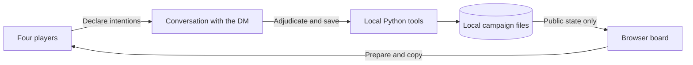

<div align="center">

# Il Tavolo

### Your adventure has a save file.

A local tabletop companion for four players and a chat Dungeon Master.
Keep the story in the conversation. Put the world, characters and consequences on the table.

**[Guida italiana](README.it.md) · [Get started](docs/GETTING_STARTED.md) · [DM guide](docs/DM_GUIDE.md) · [Contribute](CONTRIBUTING.md)**


-765a87)


</div>

You return to a campaign after a week. Who still has a spell slot? Where did the
party stop? Which clues were facts, and which were someone's theory?

Il Tavolo keeps that state in ordinary local files and gives your group a shared
browser board. A human DM—or a chat assistant with filesystem access—resolves
declared actions and saves the consequences. Players keep control of their
characters. Your next session starts from the actual save.

## At your table

| Bring the story | Keep the details |
| --- | --- |
| **Four independent characters** | 12 SRD classes, five species, standard-array creation, individual HP, equipment and resources. |
| **A world you can explore** | Regional atlas, discovered places, scenes, quests and a shared journal. |
| **Combat you can follow** | Initiative, conditions, tactical tokens, measurements and spell-area previews. |
| **Memory between sessions** | Save exports, rotating backups, a private DM log and explicit handoffs. |
| **Atmosphere when you want it** | Local soundscapes, an illustration gallery and original dungeon-map examples. |
| **Tools for a careful DM** | Revision checks, recorded dice and retry-safe operations for supported actions. |

The interface and game text are in **Italian**. This README is in English so
contributors can find their way in; the [Italian guide](README.it.md) explains
the player experience.

## Open your first table

Install **Python 3.10 or newer**. The core application uses the standard library:
there are no runtime packages to install, no account and no API key for the board.

```bash
python server.py
```

Open **http://127.0.0.1:8765**. On a fresh checkout, the server creates an original
demo in `data/`. On Windows, double-click **`AVVIA.cmd`** to launch the server and
open the browser; **`ARRESTA.cmd`** closes the verified local process.

1. In **Il gruppo**, let each of the four players create a character.
2. Agree on the opening with the DM. Filling the fourth seat does not start the story.
3. Declare an action in chat: `Ada: osservo gli annunci sul molo.`
4. The DM resolves it and saves the result. The board refreshes in about two seconds.

The browser can prepare and copy an intention; **you still send it to your chat**.
Il Tavolo does not contain a chatbot or call an LLM. An assistant's subscription,
filesystem permissions and capabilities are separate from this application.

Already have a table in this folder? Existing saves are preserved. See
[setup and recovery](docs/GETTING_STARTED.md) before moving any files.

## A board, a conversation, a persistent world



Rules summaries support **SRD 5.1, based on the 2014 rules**. The DM still checks
targeting, distances, prerequisites, reactions and table agreements. Suggested
actions and prepared encounters are starting points for choices.

The included **Portolume** setting is an original demonstration with an empty
party. It is a small framework you can expand, not a complete published campaign.
Commercial adventures, their PDFs and OCR, real player saves and private session
notes are excluded from the public source distribution.

## Build on it

```bash
# Initialize without launching; existing tables are left intact.
python tools/setup_demo.py
python tools/dnd.py validate

# Read the DM-only context and discover supported operations.
python tools/play.py context
python tools/play.py --help

# Unit and HTTP tests use temporary tables.
python -m unittest discover -s tests -q
```

Node.js checks the optional browser rules tests and JavaScript syntax. For the
full map/browser checks, install `shapely` and `playwright`, then install Chromium;
see [CONTRIBUTING.md](CONTRIBUTING.md). They are development extras, not gameplay
dependencies.

Useful entry points:

- [DM workflow and safety of saves](docs/DM_GUIDE.md)
- [Supported game operations and their limits](tools/PLAYBOOK.md)
- [Original dungeon maps and SVG/PNG exports](tools/DUNGEON_MAPS.md)
- [Public export and publishing guide](docs/PUBLISHING.md)
- [Changes prepared for the first public release](CHANGELOG.md)

## Scope and privacy

The server binds to **127.0.0.1** for a shared computer. It has no accounts or
remote multiplayer hosting. Do not expose it directly to the Internet.
All data returned in the public campaign APIs is visible to the table; private
DM files are kept outside the web routes. Anyone with filesystem access can
still read local files.

Runtime saves, DM notes, sessions and supplied sources stay outside Git in the
public distribution. The original working table may have an older private Git
history: publish a [fresh public export](docs/PUBLISHING.md), rather than that history.

## Help shape the next session

Try the demo, report a reproducible bug, improve Italian rules cards or help make
keyboard and small-screen navigation clearer. Focused pull requests with a
specific table problem are welcome. [Contribution guide →](CONTRIBUTING.md)

Original code is **MIT**. Adapted SRD rules remain **CC BY 4.0**. See
[attribution and asset provenance](ATTRIBUZIONI.md) for the boundaries.
This is an independent project, without endorsement by Wizards of the Coast or OpenAI.
